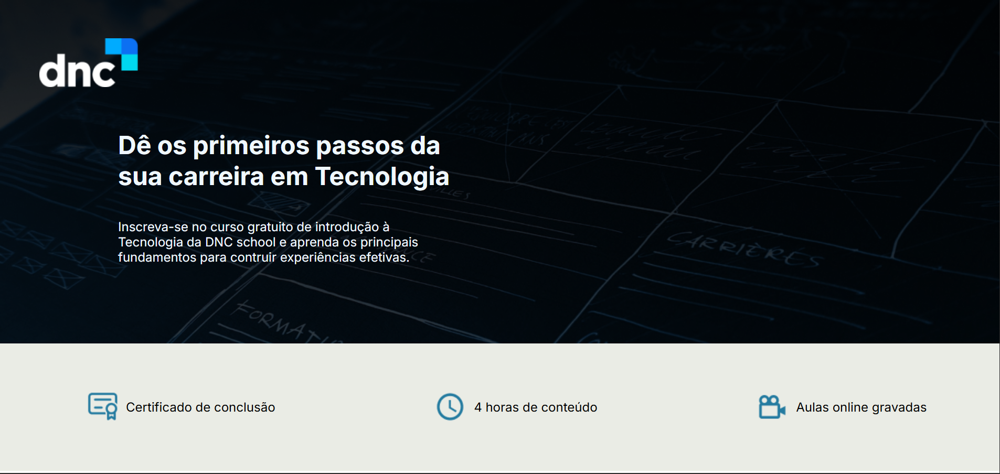
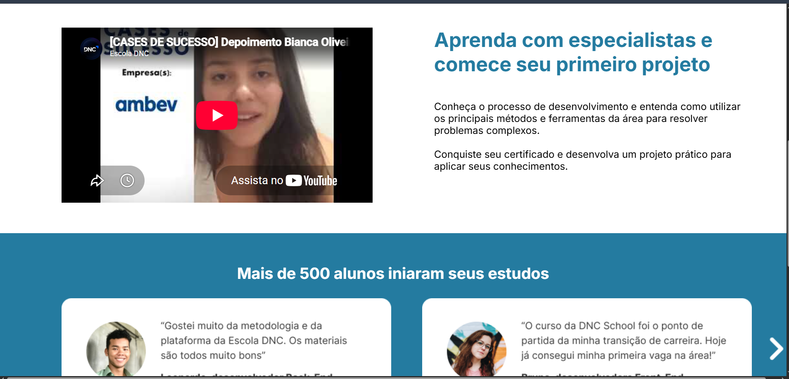
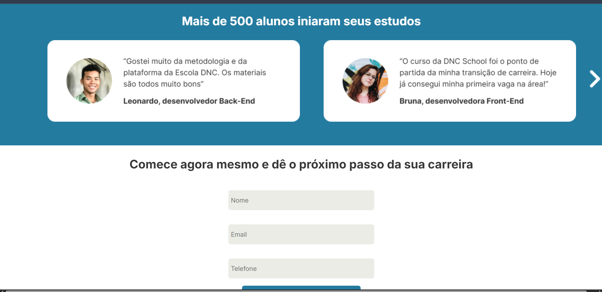
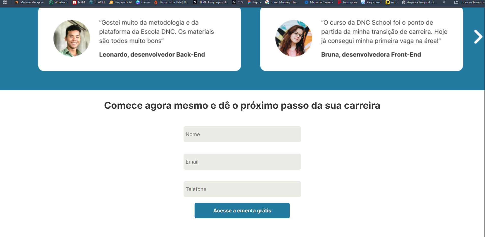

# Landing Page DNC

Desenvolvi esta landing page durante meus estudos no curso de tecnologia da Escola DNC, colocando em prática os fundamentos de HTML, CSS e JavaScript. A proposta foi construir uma página de apresentação de um curso gratuito, reunindo informações, vídeo, depoimentos e um formulário de interesse.

**Versão disponível: somente para computador (desktop).** Desenvolvi o layout para visualização em computadores; o projeto não possui versão adaptada para celulares ou tablets.

**[Acesse a demonstração online pelo computador](https://emanoel-landing-pag-dnc.netlify.app/)**

## O desafio

Meu desafio foi transformar a proposta visual do exercício em uma página navegável, organizar o conteúdo em seções e adicionar interações com JavaScript. Trabalhei a apresentação do curso e o caminho até o formulário, aplicando os conceitos de estruturação, estilização e manipulação de elementos da página.

## Conheça a página

### 1. Apresentação do curso

Na abertura, organizei a identidade visual da DNC, a chamada principal e o texto de apresentação. Logo abaixo, destaquei as informações do curso anunciado: certificado de conclusão, quatro horas de conteúdo e aulas online gravadas.



### 2. Vídeo e conteúdo de apoio

Incluí um vídeo do YouTube por meio de um `iframe` e posicionei, ao lado, o texto sobre o aprendizado e a realização de um primeiro projeto. Nessa seção, pratiquei a organização de conteúdo em colunas com CSS Grid e a incorporação de mídia externa.



### 3. Depoimentos com navegação

Implementei a navegação entre os depoimentos com JavaScript. Ao clicar na seta da direita, o card de Leonardo é ocultado e o de Samantha aparece, enquanto o de Bruna permanece visível. A seta da esquerda permite retornar à apresentação inicial.

Os cards utilizam imagens fornecidas no exercício. Para controlar essa interação, selecionei os elementos pelo identificador e alterei sua exibição no DOM.



### 4. Formulário de interesse

Estruturei um formulário com os campos nome, e-mail e telefone, além do botão “Acesse a ementa grátis”. Nome e e-mail são obrigatórios, e o campo de e-mail utiliza a validação nativa do navegador.

Configurei o envio por `POST` para o Sheet Monkey e incluí um campo oculto para registrar a data e a hora do envio. Essa integração depende da disponibilidade e da configuração do serviço externo; a presença do formulário no código não confirma, por si só, o recebimento atual dos dados.



## Tecnologias que utilizei

| Tecnologia | Como apliquei no projeto |
| --- | --- |
| HTML5 | Estrutura da página, vídeo incorporado e formulário. |
| CSS3 | Cores, tipografia, espaçamentos, layout com Grid e Flexbox e efeitos no botão. |
| JavaScript | Manipulação do DOM e alternância dos depoimentos. |
| Google Fonts | Uso da fonte Inter na interface. |
| Sheet Monkey | Configuração do destino de envio do formulário. |
| Netlify | Publicação da demonstração da página. |

## O que aprendi

Com este projeto, pratiquei a construção de uma página completa usando HTML, CSS e JavaScript, sem frameworks. Aprendi a distribuir textos e imagens em seções, incorporar um vídeo externo, trabalhar estados de exibição com JavaScript e configurar um formulário para envio a um serviço externo.

Também exercitei a organização dos arquivos e a publicação de um projeto estático para compartilhar o resultado online.

## Como executar localmente

1. Clone o repositório:

   ```bash
   git clone https://github.com/EmanoelAngelo/projeto-landing-page.git
   ```

2. Entre na pasta `projeto-landing-page`.
3. Abra o arquivo `index.html` no navegador ou utilize a extensão Live Server do VS Code.

Não há etapa de compilação nem instalação de dependências. O carregamento da fonte, a reprodução do vídeo e o envio do formulário dependem de conexão com a internet e dos respectivos serviços externos.

## Organização dos arquivos

| Arquivo ou pasta | Conteúdo |
| --- | --- |
| `index.html` | Estrutura e conteúdo da landing page. |
| `style.css` | Estilos e organização visual. |
| `index.js` | Lógica de navegação dos depoimentos. |
| `imagens/` | Recursos visuais utilizados pela página. |
| `docs/images/` | Capturas de tela utilizadas neste README. |

## Contexto e próximos passos

Este é um projeto de estudo desenvolvido a partir de uma atividade da Escola DNC. A identidade visual, os textos de divulgação e os depoimentos fazem parte do material do exercício.

A versão atual utiliza medidas e espaçamentos fixos em diversas seções, sem regras específicas para telas menores. Como evolução, posso trabalhar a adaptação para dispositivos móveis, melhorar a acessibilidade dos controles e campos e acrescentar uma confirmação de envio do formulário.

---

Desenvolvido por **[Emanoel Angelo](https://github.com/EmanoelAngelo)** durante meus estudos na **Escola DNC**.
